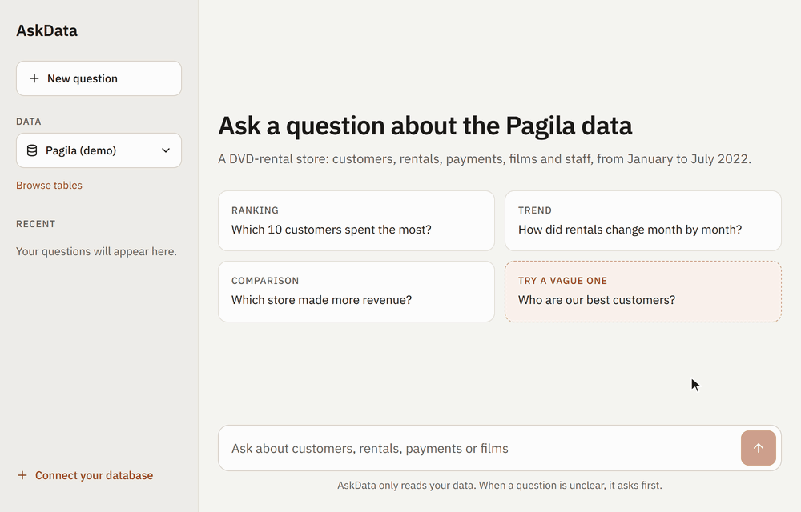
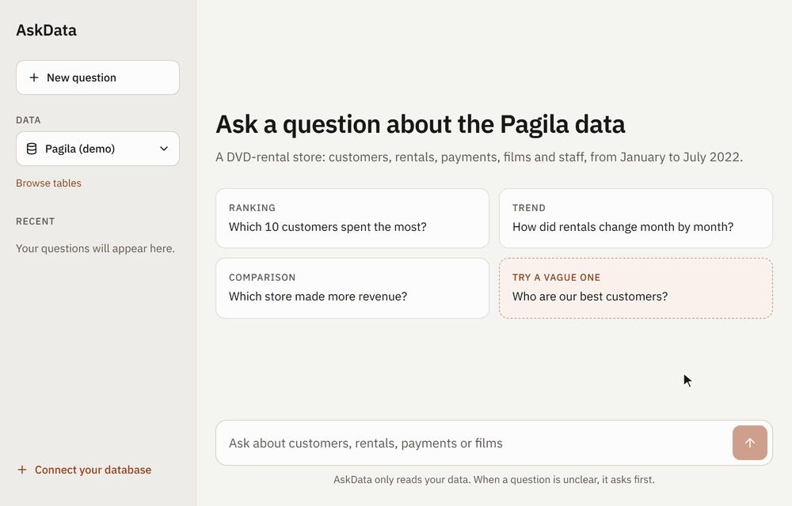
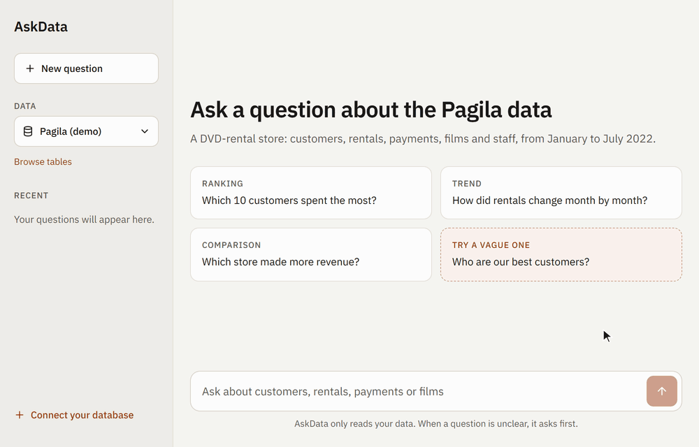
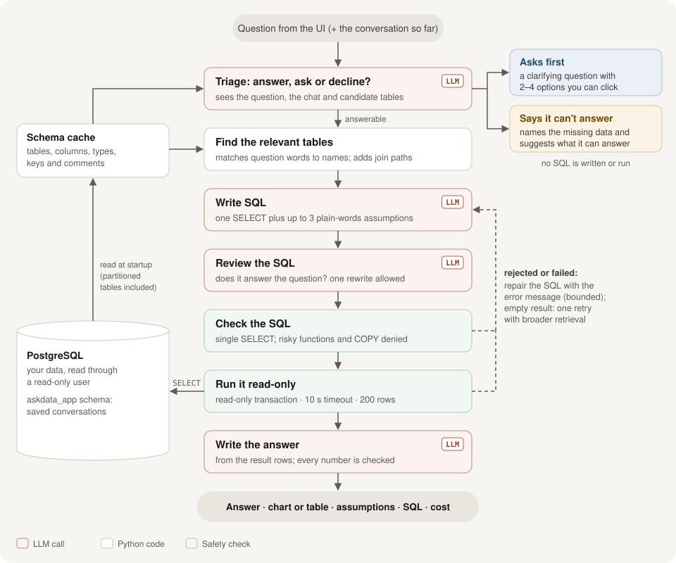
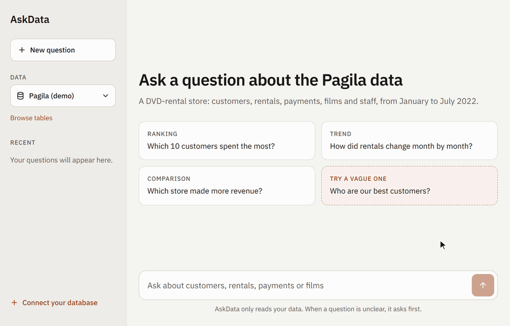

# AskData

**Ask your PostgreSQL database questions in plain English, and know when to trust the answer.**

- **Answers** with a sentence, a chart, and the SQL behind it
- **Asks** when your question could mean more than one thing
- **Says so** when the data can't answer, and suggests what it can



AskData is for people who know their business but don't read SQL. They can't check the query, so the app has to be careful about when it answers at all, and open about how it got there.

## What it does

### Answers, and shows how

You get the answer as a sentence with the names and numbers that matter, then a chart or a table you can copy or download as CSV. Under "I assumed" it lists the choices it made for you, like what "spent" means or which dates it used. "How I got this" shows how it read the question, which tables it used, the SQL, and what the answer cost.

### Asks when a question could mean more than one thing

"Who are our best customers?" could mean the ones who spent the most or the ones who rented the most. AskData asks, and each option is a full question you can click.



### Says when the data can't answer

"What is the profit margin for each film?" needs costs that the database doesn't record. AskData says what's missing, runs no query, and suggests questions it can answer.



It also handles follow-ups in the same conversation ("now only the top 5"), keeps past conversations under Recent, lets you browse the tables and their columns, and connects to your own PostgreSQL database with a read-only user.

## How well it works

AskData is tested on 52 questions about two demo databases ([Pagila](https://github.com/devrimgunduz/pagila), a DVD-rental store, and `retail_ops`, a synthetic retail company). The set includes questions that are vague on purpose and questions the data can't answer. Each answer is checked against the result of a hand-written SQL query.

| Questions | Answered correctly | Vague: asked first | Unanswerable: declined | Wrong answers | Median time | Cost per question |
|---|---|---|---|---|---|---|
| All 52 | 35 of 38 | 6 of 8 | 6 of 6 | **3 of 52 (6%)** | 8.3 s / 8.7 s | $0.0072 / $0.0051 |
| 32 held-out | 19 of 20 | 4 of 6 | 6 of 6 | **1 of 32 (3%)** | 7.8 s / 8.3 s | $0.0064 / $0.0044 |

"Wrong answers" are the ones that matter most here: a confident answer that is wrong, or an answer to a question the data can't support. Asking or declining is visible to the user and doesn't count. The set was run twice; both runs gave the same outcome on every question, and the two values in the time and cost columns are run 1 / run 2.

The 32 held-out questions were written before any test run and never used to change prompts or rules. The other 20 were used during development, so the held-out row is the fairer number. Of the two vague questions it didn't ask about, one was answered with its assumption stated and one was refused. The three wrong answers are all on `retail_ops`.

Details, scoring rules and every answer from both runs: [eval/EVAL.md](eval/EVAL.md).

## How it works

<picture>
  <source media="(prefers-color-scheme: dark)" srcset="assets/readme/architecture-dark.svg">
  
</picture>

A question goes through a fixed sequence of steps in the FastAPI backend. Four of them call a language model, and each of those has one narrow job and returns structured output. Everything else is ordinary Python. There is no agent loop: the number of model calls per question is bounded, so cost and latency are predictable and every step can be tested on its own.

**1. Reading the schema.** At startup the backend reads the database catalog: tables, columns, types, primary and foreign keys, and comments. Partitioned tables are shown as one table and their partitions are hidden. Pagila's `payment` table, for example, is split into seven monthly partitions; a model that saw all eight tables would happily sum two months and call it the total.

**2. Triage: answer, ask, or decline.** Before any SQL is written, one model call sees the question, the conversation so far, and the candidate tables with all their columns. It returns one of three decisions. It's told to answer by default and to treat small choices (which period, how to break ties) as assumptions to state, not questions to ask. It asks only when readings would give materially different answers, and declines only when no column could hold the fact.

**3. Finding the relevant tables.** Retrieval scores tables and columns by the words in the question, through a small general business vocabulary ("spent" → amount, price, payment…). When two matched tables are connected only through others, it adds the shortest foreign-key path between them, so the model sees the join tables it needs.

**4. Writing and reviewing the SQL.** One call writes a single SELECT plus up to three assumptions in plain words. A second call reviews the query against the question (wrong join, wrong measure, missing filter) and can ask for one rewrite.

**5. Checking and running it.** The SQL is parsed with sqlglot and must be one read-only SELECT (details under [Safety](#safety)). It runs in a read-only transaction with a timeout and a row cap. If validation or execution fails, the error goes back to the model for a bounded repair. An empty result can trigger one retry with a wider schema search, and "this year" questions fall back to the latest year in the data, stated as an assumption. If the model answers with a constant instead of reading a table, AskData looks wider once and otherwise says it can't answer.

**6. Writing the answer.** The answer sentence is written by a small, cheap model from the actual result rows (up to 20 rows plus the highest and lowest values across all rows). Every number in the sentence is checked against the rows, the question and the data's date range; if one doesn't match, a plain template sentence is used instead.

Every response carries its cost: model calls, tokens, and dollars from a price table in `backend/app/core/config.py`. The frontend (Next.js) renders the three kinds of reply, keeps conversations, and sends follow-ups with the earlier turns as context.

| Step | Model | Code |
|---|---|---|
| Triage, SQL, review | `gpt-6.1-sol`, reasoning effort low | `sql_generation_service.py`, prompts in `app/llm/prompt_builders.py` |
| Answer sentence | `gpt-6-luna`, reasoning off | `response_formatter_service.py` |
| Retrieval, join paths | — | `retrieval_service.py`, `business_vocabulary.py` |
| Validation, execution | — | `sql_validation_service.py`, `sql_execution_service.py` |
| Orchestration, retries | — | `query_pipeline_service.py` |

## Safety

AskData is meant to be pointed at databases it doesn't own, so it doesn't rely on any single check:

- **Read-only user, checked.** Before connecting, AskData inspects the database user and refuses it, with the reasons, if it is a superuser, can create objects, can insert, update, delete or truncate any table, or can read or write server files. The demo itself runs as a read-only user.
- **SQL validation.** One statement, SELECT only. `COPY` and risky functions (`pg_read_file`, `pg_sleep`, `dblink`, large-object and admin functions, `set_config`…) are denied anywhere in the query, and so is AskData's own session schema.
- **Limits.** Read-only transaction, 10-second statement timeout, at most 200 rows (`QUERY_TIMEOUT_SECONDS`, `MAX_RESULT_ROWS`).
- **Secrets.** Connections added in the UI live in memory only. Passwords are masked in logs and error messages.
- **Hosted demos.** `ASKDATA_ALLOW_CUSTOM_DB=false` turns off "Connect your database".



## Run it locally

You need Python 3.11+, Node.js 20+, Docker and an OpenAI API key.

```bash
make docker-up                                # PostgreSQL 16 on localhost:55432, Pagila loaded
cp backend/.env.example backend/.env          # then add your OPENAI_API_KEY
cp frontend/.env.example frontend/.env.local
make backend-install && make frontend-install
make backend-dev                              # http://127.0.0.1:8000
make frontend-dev                             # http://127.0.0.1:3000
```

Switch the demo database with `make load-dataset DATASET=retail_ops` (or `pagila`), then `make reload-schema-cache` if the backend is running.

Tests: `make verify` runs the backend tests (no API key needed), frontend lint and build; `make eval-test` runs the scorer's tests. `make eval DATASET=pagila SPLIT=dev LABEL=mine` runs the evaluation against your running backend (about $0.005–0.007 per question).

On Windows the Makefile needs a Unix shell; otherwise run the commands inside each target, with `backend\.venv\Scripts\python.exe` as the Python.

## Connect your own database

### Create a read-only user

AskData won't connect with a user that can change data, create objects, read server files, or is a superuser. Create a read-only one first (as an admin, with your own names and password):

```sql
CREATE ROLE askdata_ro LOGIN PASSWORD 'choose-a-strong-password';
GRANT CONNECT ON DATABASE your_database TO askdata_ro;
GRANT USAGE ON SCHEMA public TO askdata_ro;
GRANT SELECT ON ALL TABLES IN SCHEMA public TO askdata_ro;
-- tables created later in this schema:
ALTER DEFAULT PRIVILEGES IN SCHEMA public GRANT SELECT ON TABLES TO askdata_ro;
-- optional, enforced by the server as well:
ALTER ROLE askdata_ro SET default_transaction_read_only = on;
ALTER ROLE askdata_ro SET statement_timeout = '15s';
```

On PostgreSQL 14 or older, also run `REVOKE CREATE ON SCHEMA public FROM PUBLIC;` (newer versions do this by default). Repeat the USAGE and SELECT grants for every other schema you want AskData to see. PostgreSQL 12 or newer is required.

Then click **Connect your database** and paste `postgresql://askdata_ro:…@host:5432/your_database`, or fill in the fields. Table and column comments help: they are passed to the model. To point the backend itself at your database, set `DATABASE_URL` in `backend/.env`.

## Tech stack

- **Frontend:** Next.js 16, React 19, TypeScript, Tailwind CSS, Recharts
- **Backend:** FastAPI, Pydantic, psycopg 3, sqlglot, OpenAI Responses API
- **Database:** PostgreSQL 16 (Docker Compose for the demo)

```text
backend/    FastAPI app: pipeline, prompts, safety checks, tests
frontend/   Next.js app
eval/       52 questions, saved gold results, scorer, results
demo_data/  Pagila and retail_ops dumps
```

## Limitations

- Tested on two small demo databases and 52 questions; a difference of one or two questions is within run-to-run noise.
- One model family (OpenAI). Answers vary a little between runs.
- An answer takes about 8–9 seconds (median), because it needs four model calls.
- The number check catches invented numbers, not a correct number attached to the wrong name.
- The answer sentence sometimes leaves out a tie at the top of a ranking.
